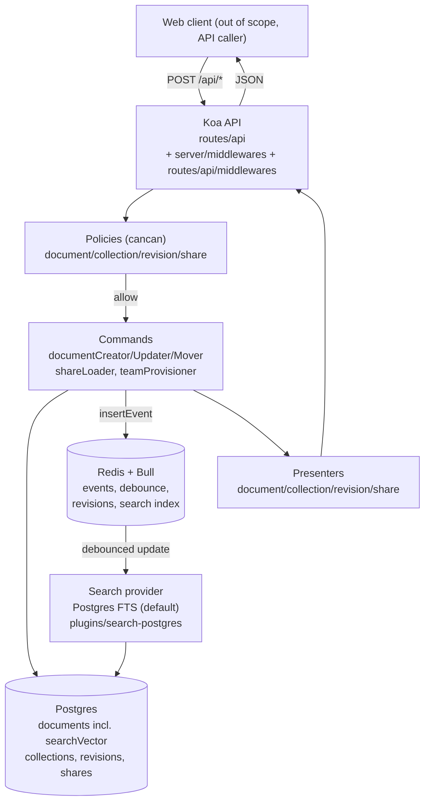
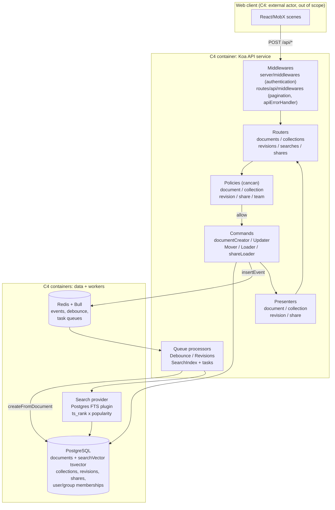
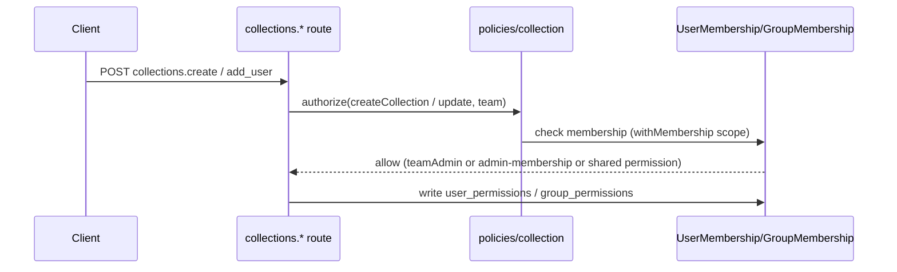
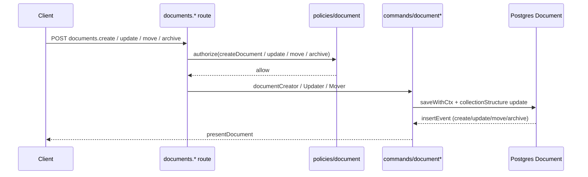
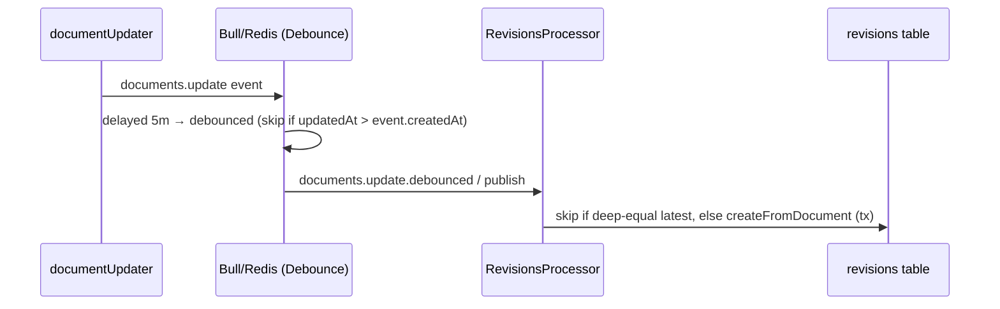
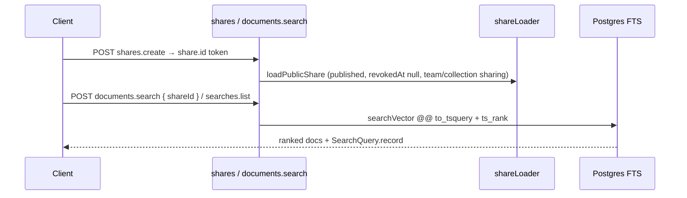

# Sprint 1 — Deliverable B: Data Flows (sketches)

The Mermaid blocks below are the single source of truth for the diagrams (they render in PR review; no standalone copies are kept). Container + component views are C4-style sketches, not strict C4.

### Component view (API internals)

## Flows in scope (4)

### 1. User/Team + collection permissions

Key rule: shared (`read/read_write`) open to team; private (`permission=null`) and guests require explicit row. See `ARCHITECTURE.md` Flow 1.

### 2. Document lifecycle

Row-lock + `DocumentConflictError` on concurrent update; move fixes `documentStructure` index.

### 3. Revisions (async)

Read path: `revisions.list/info` + `documents.restore { revisionId }`. Rename-only `revisions.update`; `delete` Admin-only.

### 4. Search + share link

Token = `Share.id` (UUID); pretty `urlId` slug needs `teamId`. `SearchIndexProcessor` is no-op for default postgres provider.

## 5th (optional, deferred)

Background indexing / event-bus fan-out (`DocumentPublishedNotificationsTask`, external search providers). Sketched only as `Redis → Search` edge above; full sequence deferred to Sprint 2 if needed.
